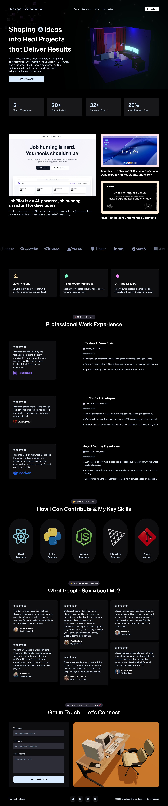

# 3D Portfolio

A modern 3D portfolio built with React, Vite, Tailwind CSS, and Three.js to showcase skills, projects, and experience in an immersive, interactive experience.



## Features

- Interactive 3D hero scene and animated UI
- Responsive portfolio layout for desktop and mobile
- Experience, timeline, and project showcase sections
- Tech stack and client/logo highlights
- Contact form integration
- Lightweight React + Vite setup for fast development

## Tech Stack

- React
- Vite
- Tailwind CSS
- Three.js
- React Three Fiber
- GSAP

## Local Development

```bash
npm install
npm run dev
```

## Production Build

```bash
npm run build
```

## Preview

```bash
npm run preview
```

## Screenshot

The project preview is shown above and is stored at the root as `screenshot.png`.
